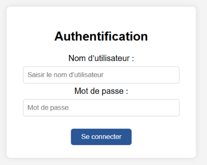
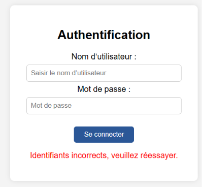
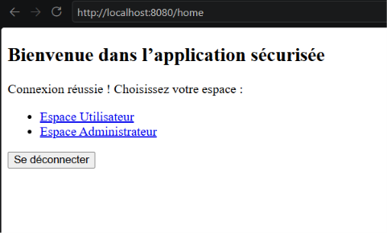
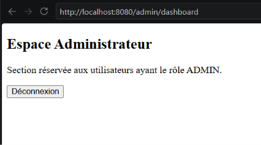
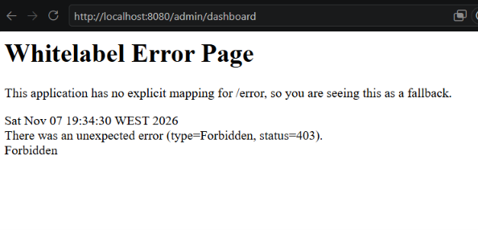

# TP 10 – Formulaire de connexion personnalisé (Spring Security)

Remplacement de la page de connexion par défaut de Spring Security par un formulaire HTML (Thymeleaf), avec gestion des erreurs, des redirections, de la déconnexion et des accès par rôle.

## Technologies

- Java 21, Spring Boot 3.5
- spring-boot-starter-web, security, thymeleaf, devtools

## Structure

```
src
 ├─ main
 │   ├─ java/ma/fstg/security
 │   │   ├─ SecurityApplication.java
 │   │   ├─ config/SecurityConfig.java
 │   │   └─ web/AuthController.java
 │   └─ resources/templates/
 │       ├─ login.html
 │       ├─ home.html
 │       ├─ admin-dashboard.html
 │       └─ user-dashboard.html
 └─ test/java/ma/fstg/security/AuthFlowTest.java
```

## Lancer l'application

```bash
./mvnw spring-boot:run        # Linux / macOS / Git Bash
mvnw.cmd spring-boot:run      # Windows
```

Puis ouvrir http://localhost:8080/login

| Rôle  | Utilisateur | Mot de passe |
|-------|-------------|--------------|
| USER  | `user`      | `1111`       |
| ADMIN | `admin`     | `1234`       |

## Flux d'authentification

1. L'utilisateur demande une ressource protégée (ex. `/user/dashboard`).
2. La `SecurityFilterChain` intercepte la requête.
3. Non authentifié → redirection vers `/login` (notre page personnalisée).
4. Le formulaire envoie un `POST` vers `/authenticate` (traité par Spring, sans contrôleur).
5. Spring compare les identifiants avec le `UserDetailsService`, crée un objet `Authentication` et le stocke dans le `SecurityContext`.
6. Succès → `/home` ; échec → `/login?error=true`.

## Rôle des composants

- **`SecurityFilterChain`** : la chaîne de filtres qui intercepte chaque requête et applique les règles.
- **`HttpSecurity`** : le builder qui configure cette chaîne (règles d'accès, formLogin, logout).
- **`UserDetailsService`** : fournit les utilisateurs (ici en mémoire via `InMemoryUserDetailsManager`).

## Résultats des tests (étape 8)

| Action                                  | Comportement attendu                 | Résultat |
|-----------------------------------------|--------------------------------------|----------|
| Tentative d'accès sans login            | Redirection vers `/login`            | ✅ 302 → `/login` |
| Connexion réussie                       | Redirection vers `/home`             | ✅ 302 → `/home` |
| Mauvais mot de passe                    | Retour sur `/login?error=true`       | ✅ 302 → `/login?error=true` |
| Déconnexion                             | Redirection vers `/login?logout=true`| ✅ 302 → `/login?logout=true` |
| Accès à `/admin/dashboard` sans rôle    | Erreur 403 – Accès refusé            | ✅ 403 |

## Captures d'écran

### 1. Page de connexion personnalisée (`/login`)


### 2. Mauvais mot de passe (`/login?error=true`)


### 3. Connexion réussie → page d'accueil (`/home`)


### 4. Espace Administrateur (`/admin/dashboard`, connecté en `admin`)


### 5. Accès refusé (`/admin/dashboard`, connecté en `user`) → 403


## Tests automatiques

Ces comportements sont aussi vérifiés automatiquement par `AuthFlowTest` :

```bash
./mvnw test
```

## Remarque sur la déconnexion

La protection CSRF étant active, Spring Security n'accepte la déconnexion qu'en **POST** sur `/logout`.
Un simple lien `<a th:href="@{/logout}">` (GET) afficherait une erreur 404. Les pages dashboards utilisent donc un petit formulaire `POST` (Thymeleaf y ajoute automatiquement le jeton CSRF).
